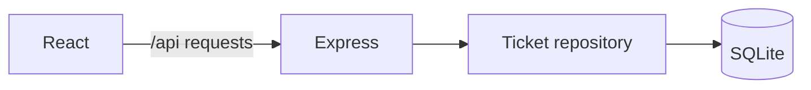

# Service Request Management

A small app for managing service tickets in one screen,
which supports creating tickets, searching by title, filtering by status, pagination, and updating a ticket's status directly from the list.

The frontend uses React and TypeScript. The backend uses Node.js and Express, with SQLite for storage. The UI is built with plain HTML and CSS, without a component library.

## Run locally

You need Node.js **22.13 or newer**, npm 10 or newer, and a modern browser. The `.nvmrc` file uses Node 24. There is no separate database service to install.

From the project root:

```bash
npm ci
npm run dev
```

This starts both the frontend and backend:

- **Frontend:** http://localhost:5173
- **Backend health check:** http://localhost:3001/api/health
- **Tickets API:** http://localhost:3001/api/tickets

The database is created automatically on the first run. An empty database gets 25 sample tickets, so there is something to search and paginate straight away. Press `Ctrl+C` to stop both services.

To run them in separate terminals, use `npm run dev:server` in one terminal and `npm run dev:client` in another. Both commands should run from the project root. Don't also run `npm run dev` at the same time, since it starts those same services.

On PowerShell, use `npm.cmd` instead of `npm` if script execution is blocked.

## Build and run

```bash
npm run build
npm start
```

Open http://localhost:3001. In this mode, Express serves the compiled frontend as well as the API, so Vite is not needed. Stop the development backend first if it is already using port 3001.

The build runs the type checker and writes the frontend to `dist/client/` and the backend to `dist/server/`. The server listens on `127.0.0.1` for local use.

## App Structure

```text
client/src/
  components/           Search form, create form, ticket table, and status selector
  hooks/useTickets.ts   List requests, applied filters, pagination, and stale responses
  api.ts                HTTP requests and error handling
  App.tsx               Connects the components and coordinates status updates
  styles.css            Layout, RTL, and responsive styling
server/
  app.ts                API routes, request validation, and error responses
  ticket-repository.ts  SQL queries
  database.ts           SQLite connection and schema setup
  seed.ts               Sample tickets
  config.ts             Environment settings
  index.ts              Server startup and shutdown
  tests/                Backend integration tests
shared/tickets.ts       Shared types, status labels, and validation schemas
e2e/                    Playwright browser tests
```



During development, Vite forwards `/api` requests to Express. After a production build, Express serves both sides. The frontend can therefore use the same relative API URLs in both modes.

The routes handle HTTP and validation, while the repository handles SQL. I kept these separate so that request handling doesn't get mixed with database queries. A separate service layer felt unnecessary for the small amount of business logic here.

## Data storage

Tickets are stored in `data/tickets.sqlite`. This is a file on disk, so creating a ticket or updating its status survives a server restart. The database and its temporary files are excluded from Git.

- `id`: Unique integer generated by SQLite
- `title`: Required text, trimmed before saving
- `description`: Optional text, an omitted description becomes an empty string
- `status`: `open`, `in_progress`, or `closed`
- `created_at`: Server-generated timestamp in UTC
- `version`: Starts at 1 and increases with every status update

The `ticket_creation_requests` table stores each creation key, a hash of the validated input, and the original response. The ticket and this record are saved in the same transaction. This lets the server safely replay a successful create even after a restart.

Dates are displayed in the `Asia/Jerusalem` time zone. Status labels are `open` = פתוחה, `in_progress` = בטיפול, and `closed` = סגורה.

On startup, the app creates the schema if needed and inserts sample data only when the tickets table is empty. Running the seed command again doesn't overwrite existing tickets or add duplicate examples:

```bash
npm run db:seed
```

Editing `server/seed.ts` changes the examples used for a new database, it doesn't update tickets already saved. To try the edited examples in a fresh database, set `DATABASE_PATH` to a new file and restart the backend.

The 25 examples include different statuses, different dates, and empty descriptions. They are inserted from oldest to newest, so newer examples receive larger ticket numbers. Listing uses `created_at DESC, id DESC`: date comes first, and the larger number wins when two timestamps match.

The schema version is stored in SQLite's `user_version`. The current version is 2. Existing databases are upgraded automatically in a transaction: tickets keep their data and receive an initial version of 1. The tables use `STRICT`, `NOT NULL`, and `CHECK` constraints for allowed values and maximum lengths. Zod checks the full input rules before a write. Queries use bound parameters, and indexes support sorting and status filtering. SQLite runs in WAL mode with a busy timeout.

## Validation and screen behavior

- A title must contain 3–100 characters after trimming whitespace from both ends.
- A description is optional and can contain up to 2,000 characters. An empty description is shown as a dash in the list.
- Validation errors first appear after clicking Create. After that attempt, they update while typing and disappear only when the field becomes valid. A successful create resets this behavior for the next ticket. The backend checks the same rules again, even if a request bypasses the form.
- The server sets the ID, creation date, and initial `open` status. These values cannot be supplied by a create request.
- A successful create clears the form and search controls, returns to page 1, and shows the new ticket first. A failed create keeps the input and doesn't add an unsaved row.
- The create button is disabled while submitting. A synchronous guard also prevents a second submission before React updates the button.
- Retrying the same create after a connection failure reuses its request key, so a ticket that was saved before the failure is not created again.
- Each row has all three statuses, and every transition is allowed. Selecting a status immediately sends a PATCH request, there is no separate Save button.
- The selector is disabled during its request. On success, the current page is fetched again with the applied search and status filter. On a regular failure, the previous status is restored and an error appears in that row.
- If another user has already updated the ticket, the stale update is rejected. A message explains what happened, and the list reloads with the applied filters. The message stays visible even if the ticket no longer matches the filter.
- If an update leaves a later page empty, the app loads an available previous page. An empty first page stays on page 1.
- Search runs on the Search button or Enter. It combines a literal title substring with the selected status and starts at page 1. Empty search text and All Statuses apply no restriction.
- Previous and Next use the last submitted filters, even if the search fields have since been edited. There are 10 tickets per page, and unavailable navigation buttons are disabled.
- The list has loading, empty, and error states. The create form stays available when no tickets match. Retry repeats the list request that failed.
- A canceled or older response cannot replace a newer search result. The hook uses both request cancellation and a generation counter to handle this.

The table keeps long descriptions to two lines, with the full text available on hover. On smaller screens, the form and list stack vertically and the table scrolls inside its card. Labels, focus indicators, live regions, and reduced-motion support are included.

Authentication, deletion, editing ticket content, attachments, comments, and ticket-detail pages are outside the assignment scope.

## API

| Method | Path | Purpose |
| --- | --- | --- |
| GET | `/api/tickets` | Search, filter, and paginate tickets |
| POST | `/api/tickets` | Create a ticket |
| PATCH | `/api/tickets/:id/status` | Change a ticket's status |
| GET | `/api/health` | Check the server and database connection |

The list endpoint accepts `q`, `status`, and `page`. Defaults are an empty query, no status filter, and page 1. Page size is fixed at 10 on the backend. Search text is limited to 100 characters, and page numbers must be positive integers up to 2,147,483,647.

```http
GET /api/tickets?status=open&page=1
```

The response contains `tickets` and `pagination`, with `page`, `pageSize`, `total`, and `totalPages`. An out-of-range page returns an empty list with the current totals. An empty result reports at least one page for display purposes.

Create request:

```json
{
  "title": "Missing invoice",
  "description": "I did not receive an invoice for my last order."
}
```

The description can be omitted. A successful create returns `201` with `{ "ticket": { ... } }`.

The frontend sends an `Idempotency-Key` header with a UUID. The API also accepts requests without this header. each of those is treated as a new create. Keys must contain 1–128 letters, digits, underscores, or hyphens.

Repeating a key with the same validated input returns the original `201` response and adds `Idempotency-Replayed: true`. Reusing a key with different input returns `409` with the code `IDEMPOTENCY_KEY_REUSED`. An omitted description and an empty one count as the same input, as do titles that differ only in surrounding whitespace.

Status update request:

```json
{ "status": "in_progress", "expectedVersion": 1 }
```

Use the ticket's `version` from the list as `expectedVersion`. A successful update returns `200` with the updated ticket and its increased version. If the version has changed, the API returns `409` with the code `VERSION_CONFLICT` and `currentTicket`, without applying the stale update. Invalid input returns `400`, a missing ticket returns `404`. Unknown input fields are rejected.

Errors use an `error` object with a user-facing `message` and, for validation errors, a `fields` object. Messages are in Hebrew to match the UI. Malformed JSON returns `400`, bodies larger than 32 KB return `413`, and unexpected failures return a generic `500` response. Details are logged on the server rather than sent to the browser. API responses are not cached.

## Configuration

The defaults work without an `.env` file. To change them, copy `.env.example` to `.env`:

```powershell
Copy-Item .env.example .env
```

On macOS or Linux, use `cp .env.example .env` instead.

| Variable | Default | Purpose |
| --- | --- | --- |
| `PORT` | `3001` | Backend port, also serves the built frontend |
| `DATABASE_PATH` | `./data/tickets.sqlite` | Database path, relative to the project root |
| `AUTO_SEED` | `true` | Set to `false` to start an empty database without sample tickets |

Restart both development services after changing `.env`, so the API proxy uses the same port as the backend. To try a clean dataset without deleting existing work, use a new `DATABASE_PATH`, such as `./data/demo.sqlite`.

## Tests

Install the test browser once after installing dependencies:

```bash
npx playwright install chromium
```

Then run everything:

```bash
npm run check
```

Individual commands are also available:

- `npm run typecheck`: TypeScript across the frontend, backend, and tests
- `npm test`: HTTP integration tests with real SQLite databases
- `npm run test:e2e`: Browser flows in Chromium
- `npm run test:e2e:ui`: The same browser tests in Playwright's interactive runner
- `npm run build`: Type checking and the production build

All 15 backend tests and 15 browser tests pass, along with type checking and the production build.

Backend tests cover validation boundaries, trimming, optional descriptions, seed ordering, pagination, literal Hebrew search, combined filters, status transitions, and error responses. They also check concurrent creates with the same key, changed-input conflicts, transaction rollback, stale status updates, database migration, and replaying a saved response after reopening the database.

Browser tests cover the actual form and table behavior: disabled buttons and selectors, empty descriptions, search with Enter, draft versus applied filters, create failures and retries, status rollback, empty-page navigation, late search responses, and mobile layout. They also exercise every status transition, the exact title and description length limits, live validation after the first attempt, a lost response after a real save, and conflicting updates from two tabs.

API tests use an in-memory database, apart from temporary files for persistence and migration checks. Browser tests start separate services on ports **3101 and 5174** and create a separate database under `data/e2e/`. They do not modify the local application database. Keep those test ports free.

To open the browser test report:

```bash
npx playwright show-report
```

## Technical decisions

- **SQLite:** keeps setup simple while still providing persistent storage and SQL. There is no database service to configure for reviewing the assignment.
- **No ORM:** there are two small tables and only a few queries. Keeping the SQL explicit makes the filters, ordering, and transactions easy to follow.
- **Shared Zod schemas:** the frontend and backend apply the same input rules. TypeScript alone cannot validate incoming HTTP data at runtime.
- **Server-side pagination and filtering:** the browser receives only the page it needs, along with totals for the same query.
- **Separate draft and applied filters:** changing a field doesn't silently change the query used for pagination.
- **Refetching after writes:** a status change can remove a row from the current filter or change the page count, so a fresh response is safer than only changing the local row.
- **One root package:** installation and development commands stay simple, while folders separate frontend, backend, and shared code.

## Current improvements

- **Validation while correcting input:** errors appear after the first submit attempt, then update as the user types. An error stays visible until the value passes validation, so entering another invalid value doesn't hide it.
- **Safe retries when creating a ticket:** the form keeps a UUID for each validated payload until a creation succeeds. If the response is lost after the server saves the ticket, retrying sends the same key and gets the original response. SQLite stores the key and ticket together, so restarting the backend doesn't lose this protection. The form's keys are kept in memory, so reloading or closing the browser starts a new submission. Saved server keys currently have no expiry.
- **Protection against conflicting status updates:** each ticket has a version. The backend changes its status only if the submitted version still matches. If two users edit the same ticket, the stale request gets a conflict response instead of overwriting the newer status. The screen explains the conflict and reloads the current page with the applied search and filter, so the user can review the latest state before trying again.

## Future improvements

- Move to PostgreSQL with an asynchronous driver if traffic grows. The current synchronous SQLite connection is enough for this small app, but database work blocks the Node event loop.
- Revisit search indexing and pagination if the dataset becomes large. Literal substring search and offset pagination keep this version simple.
- Run the existing checks in CI and add automated accessibility checks alongside keyboard and mobile review.

## Quick manual check

1. With a new database, check the three pages contain 10, 10, and 5 tickets, with descending ticket numbers.
2. Search for `חשבונית` with Open selected. Only the missing-invoice ticket should match.
3. Create a ticket without a description. It should appear first with a dash and Open status.
4. Filter by Open and change a matching ticket to Closed. It should leave the results.
5. Stop only the backend, try a search or create, then restart it and retry. Check the error and preserved input.
6. Restart the app and confirm that created tickets and status changes are still there.
7. Submit a title that is too short, then correct it. The error should stay until the trimmed title has at least three characters.
8. Open the same ticket in two tabs. Change its status in one tab, then try changing it in the other. The second tab should show a conflict and load the latest results.

## Troubleshooting

- **`node:sqlite` is not found:** Check `node --version` - Node 22.13 or newer is required
- **SQLite experimental warning:** Node 22/23 may show this warning, it doesn't mean startup failed
- **A port is already in use:** Stop the previous process or change the backend `PORT` in `.env`
- **API proxy error:** Make sure the backend is running and its port matches Vite's proxy
- **`npm start` cannot find its entry file:** Run `npm run build` first
- **Playwright cannot find Chromium:** Run `npx playwright install chromium`
- **More than 25 tickets appear:** Existing tickets are kept between runs, choose a new database path for a clean demo

Screenshots are available for [desktop](docs/preview-desktop.png) and [mobile](docs/preview-mobile.png).
